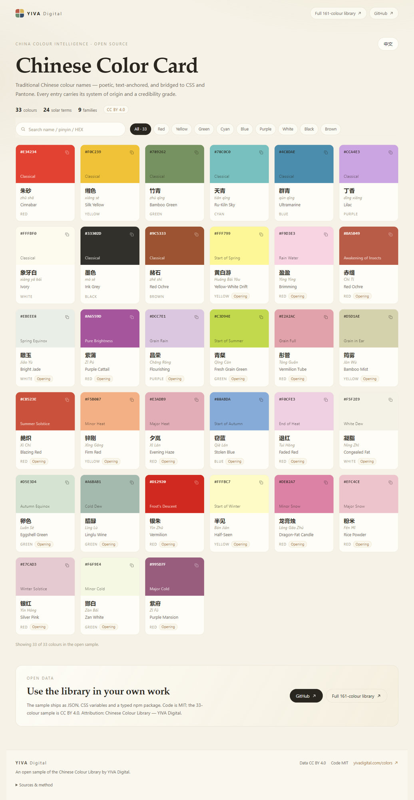

# Chinese Color Card · 中国传统色卡

An open colour card of traditional Chinese colours, maintained by [YIVA Digital](https://yivadigital.com).
It ships as a standalone static demo and as the typed npm package [`@yiva/chinese-colors`](packages/chinese-colors).

**Live tool (all 161 colours):** <https://yivadigital.com/tool/chinese-color-card>
**Standalone demo (this repo's 33 colours):** <https://madfeifei.github.io/yiva-chinese-colors/>
**Colour library:** <https://yivadigital.com/colors>



## What you get

- **33 colours** — 9 classical anchors (one per family: 赤/黄/绿/青/蓝/紫/白/黑/褐) plus the 24 solar-term opening colours (起色).
- **Values** — HEX, RGB, HSL and OKLCH for every colour.
- **Nearest matches** — CSS named colour and Pantone reference, each with an OKLab ΔE.
- **Provenance** — system of origin, credibility grade, classical citation and bilingual cultural notes.
- **A real UI** — search, family filters, Chinese/English toggle, copy-to-clipboard and a detail sheet.
- **One source of truth** — `data/sample.json` feeds both the demo and the npm package (JSON, CSS variables, CSV).

## Quick start

```bash
npm install
npm run dev        # demo at http://localhost:5178
npm run build      # data -> app -> package
```

Repository layout:

```
data/sample.json              the 33-colour open sample (canonical)
apps/card/                    React + Vite demo -> GitHub Pages
packages/chinese-colors/      @yiva/chinese-colors (TypeScript, JSON, CSS, CSV)
scripts/build-package-data.mjs
scripts/install-hooks.mjs     sets up the pre-commit secret scan
.github/workflows/deploy.yml  demo deployment
```

### Pre-commit secret scan

`npm install` points `core.hooksPath` at `.githooks/` and downloads gitleaks into
`.git/gitleaks/` (skipped when `CI=true`). Every commit then scans the staged diff and blocks on a
finding. Run `npm run secrets:staged` to check by hand, or `npm run hooks:install` to repair the
setup. The binary is never committed.

## Use the package

`@yiva/chinese-colors` is not on the public npm registry yet. Until it is, install it straight from a clone:

```bash
npm install ./packages/chinese-colors
```

```ts
import { colors, meta, byName, byFamily, byTerm, search, toCss } from "@yiva/chinese-colors";

colors.length;        // 33
byName("黄白游");      // solar colour, #FFF799
byFamily("赤");        // every red in the sample
search("spring");     // free-text search
toCss();              // :root { --cn-<slug>: #…; }
```

The package also exports `data.json`, `chinese-colors.css` and `chinese-colors.csv`.

## Why is this only 33 colours?

The full Chinese Colour Library has **161 colours**: 65 classical names and 96 solar-term colours
(24 terms × 4 roles 起/承/转/合). This repository is the **open sample**: one classical anchor per
family and one opening colour per solar term. The complete set, all four roles and the deeper
provenance live at <https://yivadigital.com/colors>.

That keeps the open repo useful for developers and designers without turning the full library into
an uncredited bulk download.

## Licence

- **Code** — MIT. See [LICENSE.md](LICENSE.md).
- **Data** — CC BY 4.0. Attribution: *Chinese Colour Library — YIVA Digital (https://yivadigital.com/colors)*.

Pantone and CSS values are **nearest perceptual matches** (OKLab), not official references.
Traditional Chinese colours have no single standard value; the HEX values are common reference
conversions. See the sources listed in `data/sample.json` → `meta.sources`.

## Credits

Colour names and citations come from public-domain Chinese classical texts and openly published
colour references. The 起/承/转/合 solar-term framework follows 郭浩 / 李健明,
《中国传统色：故宫里的色彩美学》(2020). Solar-term values are transcribed via cncolor.art.
